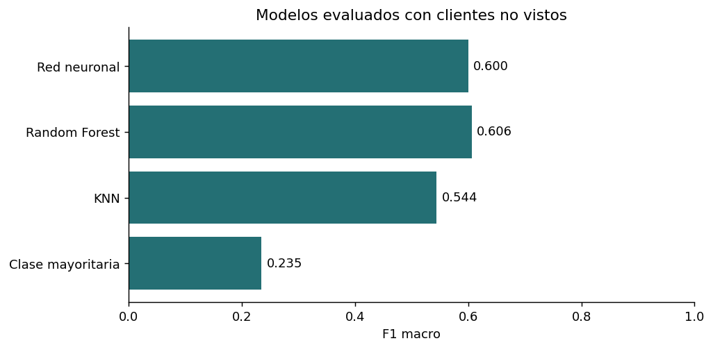

# Clasificación de puntaje crediticio con validación por cliente

Trabajo final individual del módulo FDL del Diplomado en Machine Learning de la UPB. Comparé una red neuronal, KNN y Random Forest para clasificar registros crediticios en tres categorías. El mismo cliente aparece en ocho meses; por eso reservé clientes completos para la prueba y analicé cómo cambia la evaluación frente a una división aleatoria por filas.

## Pregunta

¿Qué tan bien clasifican los modelos los registros de **clientes no vistos** usando 13 variables numéricas de ingresos, deudas, productos financieros y pagos?

## Datos

El docente del módulo proporcionó el [CSV utilizado en el trabajo](data/credit_score.csv), disponible también en la [fuente del curso](https://github.com/delveeducation/datasets/blob/main/credit_score.csv). El archivo tiene **96.696 registros**, **28 columnas** y **12.087 clientes** con ocho meses por cliente. La etiqueta `credit_score` está codificada como 0, 1 y 2. La fuente consultada no documenta qué significa cada código ni cómo se asignó.

El CSV es material de práctica del módulo e incluye columnas `name` y `ssn`. No se usan como predictores. El [detalle de los datos](data/README.md) enumera las variables usadas y el hash del archivo.

## Método

- Conservé las 13 variables numéricas de mi entrega. `customer_id` solo sirve para separar clientes; no entra al entrenamiento como predictor.
- Reservé el 20 % de los clientes para la prueba final. Separé otra parte del entrenamiento para validar la red neuronal y ajusté el escalado únicamente con los datos correspondientes de entrenamiento.
- Comparé la red densa 128–64–32 de la entrega, KNN con cinco vecinos y Random Forest con 100 árboles. Añadí una referencia de clase mayoritaria. Reporto exactitud, exactitud balanceada y F1 macro.
- Repetí Random Forest con una división por filas como diagnóstico para mostrar el efecto de compartir clientes entre entrenamiento y prueba.

El [notebook paso a paso](notebooks/analisis_crediticio_paso_a_paso.ipynb) muestra la preparación, el entrenamiento, los gráficos y la evaluación en 18 pasos.

## Mi contribución

Realicé individualmente el proyecto final del módulo: preparé las variables del CSV proporcionado, construí la red neuronal y comparé KNN y Random Forest. En este caso explico además la evaluación por cliente y sus límites.

## Resultados

| Modelo | Exactitud | Exactitud balanceada | F1 macro |
| --- | ---: | ---: | ---: |
| Clase mayoritaria | 54,32 % | 0,3333 | 0,2347 |
| KNN | 60,07 % | 0,5385 | 0,5442 |
| Red neuronal | 65,14 % | 0,5865 | 0,6000 |
| Random Forest | **65,23 %** | **0,5969** | **0,6060** |



Random Forest y la red neuronal obtuvieron resultados muy cercanos en esta partición. Frente a la clase mayoritaria, Random Forest mejoró la exactitud en 10,91 puntos porcentuales. La red se detuvo tras 11 épocas de entrenamiento con la validación separada; su exactitud en prueba fue 65,14 %.

La división aleatoria por filas compartió **10.037 clientes** entre entrenamiento y prueba y produjo **80,51 %** de exactitud con Random Forest. Al separar clientes, su exactitud fue **65,23 %**. La segunda cifra responde a la pregunta del caso; la primera muestra por qué importa elegir bien la unidad de prueba.

## Aprendizajes

Cuando un cliente aparece varias veces, dividir filas no equivale a evaluar clientes nuevos. La referencia de clase mayoritaria y F1 macro ayudan a interpretar la exactitud cuando las clases tienen tamaños distintos. En una siguiente versión documentaría cómo se asignaron las etiquetas, evaluaría datos de otro periodo y revisaría los errores por clase.

## Habilidades técnicas aplicadas

- **Pandas:** inspección, selección de columnas y comprobación de datos faltantes y distribución de clases.
- **scikit-learn:** particiones por cliente, escalado sin fuga de datos, KNN, Random Forest y métricas de clasificación.
- **TensorFlow/Keras y Matplotlib:** construcción y entrenamiento de la red neuronal, parada temprana y visualización de la pérdida y los resultados.

## Reproducir

Con Python 3.12, desde la raíz del repositorio:

```powershell
python -m pip install -r requirements.txt
```

El CSV ya está en `data/credit_score.csv`. Abre el notebook:

```powershell
jupyter lab notebooks/analisis_crediticio_paso_a_paso.ipynb
```

Ejecuta las celdas en orden. Si guardas el CSV en otra ruta, define `CREDIT_SCORE_CSV` con esa ruta antes de abrir Jupyter. El notebook puede leer la URL original si no encuentra una copia local.

## Límites

Este es un ejercicio académico con datos de práctica. Se desconoce el significado documentado de las tres categorías. Las métricas proceden de una sola partición, no de una validación temporal o externa. No bastan para tomar decisiones de concesión de crédito.
